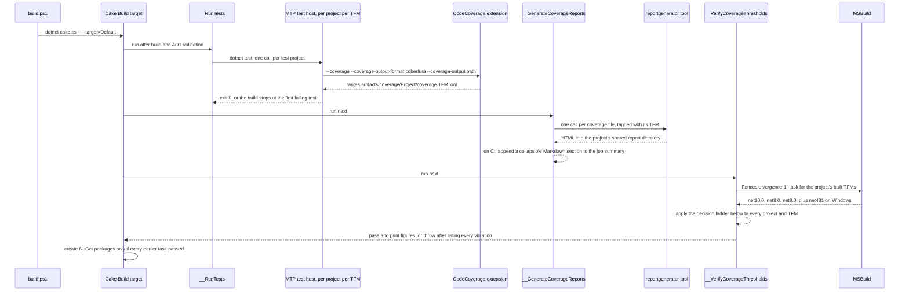
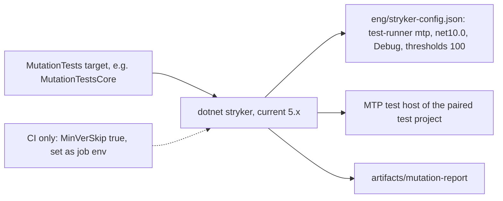
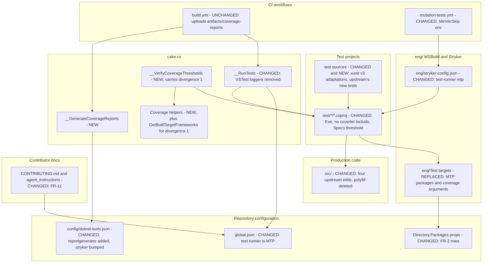

# 4. Port upstream's xunit v3 and Microsoft Testing Platform v2 test setup

Date: 2026-10-12

## Status

Accepted

## Context

Fences' tests run on xunit v2 and VSTest, and coverlet 6.0.4 collects and enforces coverage. Upstream Polly
moved to xunit v3 and Microsoft.Testing.Platform (MTP) v2 in App-vNext/Polly@1a80392b. Since then, every
upstream commit that touches tests, build scripts, coverage or Stryker assumes the new setup. Fences cannot
port those commits one at a time without re-engineering each one. Coverlet's figures are also not
reproducible across runs (#14), and on Windows the coverage gate never sees `net481` at all.

### Scope

**Parent requirement:** [specs/001-port-xunit-v3/requirements.md](../../specs/001-port-xunit-v3/requirements.md)

#### In scope

- FR-1: every test project becomes an MTP executable on xunit v3, and `global.json` selects MTP as the
  `dotnet test` runner.
- FR-2: the package and tool changes in the requirement's closed table, at the current version under its
  major-version and Dependabot rules.
- FR-3: `eng/Test.targets` tells the CodeCoverage extension to write one Cobertura file per project per
  TFM, `net481` included on Windows.
- FR-4: a new Cake task, `__GenerateCoverageReports`, runs the `reportgenerator` tool once per coverage
  file. It runs before the threshold check, so the reports survive a failing check.
- FR-5: a new Cake task, `__VerifyCoverageThresholds`, decides pass or fail per project per TFM. It
  carries one Fences divergence: a missing coverage file fails the check.
- FR-6: the Specs threshold rises to `96,95,93`. A remaining gap is investigated as a porting omission
  first.
- FR-7: upstream's test changes are applied to Fences' own files, rebranded, with upstream's test names.
- FR-8: upstream's four `src/` edits and the polyfill deletion are ported, with no public API change.
- FR-9: `eng/stryker-config.json` selects the MTP runner. The mutation workflow sets `MinVerSkip` on CI.
- FR-10: the GitHub reporter replaces the VSTest loggers. The existing upload step keeps publishing
  `artifacts/coverage-reports`.
- FR-11: the contributor documentation moves to `dotnet test --project`, and to xunit v3's
  `--filter-class` in place of `FullyQualifiedName~`.
- FR-12: a separate commit ports f35bc00d's three Specs edits.
- FR-13, FR-14, FR-15: delivery order, the mutation baseline and the reproducibility evidence. The
  Implementation Approach lists all three.
- NFR-1 to NFR-6: no new analyser warnings, no public API change, no `src/` behaviour change, a
  build-duration bound, no skipped tests, and in-process tests only.
- NFR-7: the port matches upstream, rebranded, except for the closed list of four divergences that this
  ADR records.

#### Out of scope

- Porting any other upstream commit. The sync process is [ADR 0003](0003-upstream-polly-sync-process.md).
  The non-Specs half of f35bc00d has already been ported (#44).
- Dependency changes outside FR-2, for example `Cake.Sdk` or `Microsoft.Extensions.*`. Fences tracks
  these with its own Dependabot setup (ADR 0003 D5).
- A separate HTML coverage report for each TFM. The parent requirement excludes it, and no ADR covers it.
- Renaming test methods, changing Stryker's scope or thresholds, and changing TFMs. The parent
  requirement excludes these, and no ADR covers them.
- The root cause of the `mutations-core` hang (#46), and any external coverage service. The parent
  requirement excludes both.
- Public API changes. None is expected. If one is needed, ADR 0003 D7 governs it.

### Fences cannot follow upstream's test changes, and its coverage gate does not see every framework

| Concern | Fences today | Upstream since 1a80392b |
| --- | --- | --- |
| Test framework and host | xunit 2.9.3 on VSTest (`Microsoft.NET.Test.Sdk`) | xunit v3 (`xunit.v3.mtp-v2`) on MTP v2. Each test project is an `Exe` |
| Coverage collector | `coverlet.msbuild` 6.0.4, inside `dotnet test` | `Microsoft.Testing.Extensions.CodeCoverage`, an MTP extension |
| Coverage on `net481` (Windows) | Not collected. `eng/Test.targets` turns coverage off for .NET Framework | Collected and checked |
| Coverage files | Coverlet output inside each project | `artifacts/coverage/<Project>/coverage.<tfm>.xml` |
| Report generation | ReportGenerator MSBuild task, run after each TFM's test run | `reportgenerator` local tool, run by a Cake task after all tests finish |
| Threshold enforcement | Coverlet, during each `dotnet test` run | A Cake task that reads every coverage file after the reports exist |
| Reports when the gate fails | Can be missing (the failure PR #19 fixes) | Always written, because report generation runs first |
| CI test reporting | VSTest `junit` and `GitHubActions` loggers | MTP `--report-github`, with passed tests omitted |
| Mutation runner | Stryker 4.16.0, VSTest runner | Stryker 5.0.0, `"test-runner": "mtp"`, `MinVerSkip` on CI |

Fences differs from upstream on every row of that table. So every later upstream commit that edits a test
helper, a Cake task or `eng/Test.targets` is a re-engineering task, not a rebrand. ADR 0003 D7 makes
rebranding the norm. Upstream's own f35bc00d shows the cost: #44 ported its build-props half, but its Specs
half edits three files that only exist after 1a80392b, so that half cannot land.

The coverage gate also has two gaps. Coverlet's figures vary between runs on the same commit, which #14
records. A TFM whose coverage is never collected looks the same as a TFM that passed, because nothing
lists the TFMs that should have been checked. On Windows, that gap is permanent for `net481`.

### The forces

- ADR 0003 D7 says porting rebrands and does not redesign. A Fences-shaped redesign would make every later
  upstream commit to these files a manual merge.
- NFR-7 closes the list of divergences at four. Any other difference from upstream needs the requirements
  to change first.
- FR-2 authorises dependency changes for this port only. ADR 0003 D5 skips dependency bumps by default, and
  CLAUDE.md's verification gate 6 is waived only for FR-2's rows (C-3).
- C-4 says thresholds are never lowered. C-6 keeps the TFMs as they are. C-7 keeps Stryker on `net10.0`,
  `Debug`, with thresholds of 100.
- #14 shows that a TFM which silently drops out of coverage hides a regression. Upstream's check skips a
  missing file or directory.
- The `build` job has a 20-minute timeout (`.github/workflows/build.yml:27`). Collecting `net481` coverage
  on Windows adds work inside that limit (NFR-4).
- Upstream's Cake scripts in Fences differ from the 1a80392b parent only by rebranding, so the upstream
  diff applies cleanly. The same is true of `eng/Test.targets`.
- `build.ps1` passes only `--target`, `--configuration` and `--verbosity` to Cake. It cannot run a single
  task without that task's dependencies.

## Decision

**Fences adopts upstream's xunit v3, MTP v2, coverage and Stryker setup from App-vNext/Polly@1a80392b,
rebranded, and diverges from it only by the four divergences that NFR-7 lists.**

The port lands as one upstream-SHA commit that applies 1a80392b as written, with names rebranded. One or
more Fences-only commits follow it. These make the threshold check fail on a missing coverage file, update
the contributor documentation, and close any Fences-specific coverage gap. A final commit ports f35bc00d's
Specs edits. Everything else matches upstream, including the shared HTML report directory, the
threshold-message format and the failure modes.

The closed list of divergences:

| # | Divergence | Applies when | Recorded where |
| --- | --- | --- | --- |
| 1 | The threshold check fails when a built TFM has no coverage file. Upstream skips the file. | Always | This ADR, plus a code comment at the divergence in `cake.cs` |
| 2 | The unused LegacySupport `GetOrAdd` polyfill is kept, not deleted | Only if deleting it breaks a `netstandard2.0`, `net472` or `net462` build | This ADR, a D7 code comment, and a note on #28 |
| 3 | A documented local `MinVerSkip` step for mutation runs, documentation only | Only if stryker-net#3094 affects local runs | This ADR, plus the PR body's FR-9 finding |
| 4 | Fences-only tests, or documented coverage exclusions | Only for a coverage gap that traces to code or tests upstream does not have | This ADR, plus the PR body's FR-6 list |

### The mechanism, end to end



The threshold check applies this ladder to each test project, in this order. Row 3 is the only row that is
not upstream's behaviour.

| # | Situation | Outcome | Diagnostic | Source |
| --- | --- | --- | --- | --- |
| 1 | The project declares no `<Threshold>` | Not checked. This is not an error | None | Upstream |
| 2 | A `<ThresholdType>` value is not `line`, `branch` or `method` | The build fails at once | `Unsupported <ThresholdType> value '…'.` | Upstream |
| 3 | A built TFM has no coverage file (or the project has no coverage directory) | A violation is recorded, and the check continues | `<Project> (<tfm>): no coverage file was found at '<path>'.` | **Fences divergence 1** |
| 4 | A coverage file is empty or is not valid XML | The build fails at once, at the XML load | The XML parser's exception. It need not name the project or TFM | Upstream |
| 5 | The file has no Cobertura `package` named for the covered assembly | A violation is recorded | `<Project> (<tfm>): no coverage data was found for assembly '<assembly>'.` | Upstream |
| 6 | The file has data for the covered assembly | The figures are printed | `<Project> (<tfm>): line=…%, branch=…%, method=…% for '<assembly>'.` | Upstream |
| 7 | A metric's unrounded actual value is below its required value | A violation is recorded, one for each failing metric | `<Project> (<tfm>): <metric> coverage of <actual, 0.##>% for '<assembly>' is below the required threshold of <required>%.` | Upstream |
| 8 | All projects are processed, and at least one violation exists | Each violation is logged as an error, then the build fails | `<n> coverage threshold violation(s) found. See the errors above.` | Upstream |
| 9 | All projects are processed, and there are no violations | The check passes | The figures from row 6 | Upstream |

The mutation run is unchanged except for its runner and its environment:



These invariants follow from the diagrams:

- Reports never depend on the threshold check. Cake runs `Build`'s dependencies in the order they are
  declared, and `__GenerateCoverageReports` is declared before `__VerifyCoverageThresholds`. A failing
  check therefore leaves every HTML report and every job-summary section already written.
- A failing test stops the build at `__RunTests`, before any report is generated. Upstream does the same,
  and FR-4 accepts it.
- No TFM can drop out silently. The project file's evaluated `TargetFrameworks` sets which TFMs the check
  expects. The files that happen to exist do not.
- Comparisons use the unrounded value. A figure of 99.995 against 100 fails, even though it prints as
  `100%`.
- Every violation is reported before the build fails. Rows 2 and 4 are the exceptions: they throw at
  once, as upstream does.
- The test project's `.csproj` stays the single source of truth for both the threshold triple and the
  TFM list.
- Requirements discharged: FR-3, FR-4, FR-5, FR-9, FR-10, AC-10, AC-11, AC-12, AC-13, AC-14, AC-15, AC-22.

### Where the pieces live



The arrows point from a user to the thing it depends on. Each `.csproj` imports `eng/Test.targets` through
`ProjectType=Test` (`Directory.Build.targets:3`). The Cake tasks depend on the `.csproj` files for
thresholds and TFMs, and on the `reportgenerator` tool from the tool manifest. Nothing in `src/` depends on
the test or build changes.

### Key Components

#### The roles, and what each is responsible for

| Role | Type | Responsibilities | Responsibility classifier | Collaborators |
| --- | --- | --- | --- | --- |
| Selects the test runner | `global.json` `test.runner` | Makes `dotnet test` use MTP instead of VSTest | knowing | .NET SDK, Cake `DotNetTest` |
| Runs one project's tests for one TFM | MTP test host (each test project built as `Exe` with `xunit.v3.mtp-v2`) | Discovers and runs xunit v3 tests. Hosts the coverage and reporting extensions | doing | `eng/Test.targets`, CodeCoverage extension, GitHub reporter |
| Tells each test host what to collect and where | `eng/Test.targets`, target `_UpdateTestPlatformProperties` | Knows the coverage path pattern, the results directory and the CI-only report flags. Builds the host's command-line arguments | knowing, doing | MTP test host, `ArtifactsPath` from `UseArtifactsOutput` |
| Measures coverage for one test run | `Microsoft.Testing.Extensions.CodeCoverage` | Instruments the run. Applies the default attribute exclusions. Writes one Cobertura file | doing | MTP test host |
| Holds a project's coverage policy | Test project `.csproj` | Knows the threshold triple (`<Threshold>`, optional `<ThresholdType>`) and its TFMs | knowing | `__VerifyCoverageThresholds`, MSBuild |
| Runs every test project | Cake task `__RunTests` | Calls `dotnet test` for each `test/**/*{Tests,Specs}.csproj` without rebuilding | doing | MTP test host |
| Turns coverage files into reports | Cake task `__GenerateCoverageReports` | Runs `reportgenerator` once for each file. Appends the Markdown summary on CI. Fails if `reportgenerator` exits non-zero | doing | `reportgenerator` tool, `GITHUB_STEP_SUMMARY` |
| Renders a report | `reportgenerator` local tool | Writes HTML and Cobertura, and the GitHub Markdown summary on CI | doing | `__GenerateCoverageReports` |
| Decides whether coverage is good enough | Cake task `__VerifyCoverageThresholds` | Applies the decision ladder. Collects every violation before failing | deciding | `.csproj`, coverage helpers, `GetBuiltTargetFrameworks` |
| Reads a threshold triple | `GetCoverageThresholds` | Parses `<Threshold>` and `<ThresholdType>` with coverlet's reuse-the-last-value rule | knowing | `.csproj` via `XmlPeek` |
| Names the covered assembly | `GetCoverageAssemblyName` | Removes the `.Tests` or `.Specs` suffix | knowing | none |
| Computes one file's figures | `GetAssemblyCoverage` | Loads the Cobertura file. Returns line, branch and method percentages for one package, or none | doing | Cobertura file |
| Lists the TFMs a project builds on this OS (Fences-only) | `GetBuiltTargetFrameworks` | Asks MSBuild for the evaluated `TargetFrameworks` | knowing | MSBuild (`dotnet msbuild -getProperty`) |
| Orders the pipeline | Cake task `Build` | Runs tests, then reports, then the check, then packaging | deciding | the tasks above |
| Holds mutation settings | `eng/stryker-config.json` | Knows the runner, TFM, configuration, thresholds and ignore lists | knowing | `RunMutationTests`, `dotnet-stryker` |
| Works around stryker-net#3094 on CI | `.github/workflows/mutation-tests.yml` job `env` | Sets `MinVerSkip: true` for every mutation job | knowing | MinVer, `dotnet-stryker` |

#### `_UpdateTestPlatformProperties` (in `eng/Test.targets`)

| Member | Input | Output | Error conditions |
| --- | --- | --- | --- |
| `CoverageOutput` property | `ArtifactsPath`, `MSBuildProjectName`, `TargetFramework`. A caller can override it | `artifacts/coverage/<Project>/coverage.<tfm>.xml` | None. A wrong path shows up as a missing file at ladder row 3 |
| Host arguments | `CoverageFormat` (`cobertura`), `CoverageOutput`, optional `CoverageRunSettings`, `CI` | `--results-directory`, `--coverage`, `--coverage-output-format`, `--coverage-output`. On CI it adds `--report-github --report-github-summary-include-passed false --report-xunit-junit --report-xunit-junit-filename <Project>.<tfm>.junit.xml` | None. `CoverageRunSettings` is unset, so `--coverage-settings` is never passed |

#### `__GenerateCoverageReports`

| Member | Input | Output | Error conditions |
| --- | --- | --- | --- |
| The task | `artifacts/coverage/<Project>/coverage.*.xml`, plus `GITHUB_ACTIONS`, `GITHUB_SHA` and `GITHUB_STEP_SUMMARY` | `artifacts/coverage-reports/<Project>/` (shared by the project's TFMs, so it holds the last TFM processed). On CI, one `<Project> Code Coverage report (<tfm>)` section for each file | A non-zero `reportgenerator` exit throws `Failed to generate the coverage report for '<project>' (<tfm>).` A missing directory or file is skipped, as upstream does. Divergence 1 applies only to the check |

#### `__VerifyCoverageThresholds` and its helpers

| Member | Input | Output | Error conditions |
| --- | --- | --- | --- |
| The task | Every test `.csproj`, and `artifacts/coverage/<Project>/coverage.*.xml` | Logs figures for each project and TFM, then passes | Follows the decision ladder: ladder rows 3, 5 and 7 add violations, rows 2 and 4 throw at once, and row 8 throws after logging every violation |
| `GetCoverageThresholds(csprojPath)` | `.csproj` path | A list of (metric, required) pairs, or an empty list when there is no `<Threshold>` | A value that is not a number throws a `FormatException` (upstream) |
| `GetCoverageAssemblyName(projectName)` | Test project name | Covered assembly name | None |
| `GetAssemblyCoverage(coberturaPath, assemblyName)` | Coverage file path, assembly name | (line, branch, method) as unrounded percentages. Method coverage is the share of `method` elements with `line-rate > 0`, or 100 when there are none. Returns none when no package matches | An empty or malformed file throws from `XDocument.Load` (ladder row 4) |
| `GetBuiltTargetFrameworks(csprojPath)` (Fences-only) | `.csproj` path | The TFMs from `dotnet msbuild <csproj> -getProperty:TargetFrameworks`, split on `;` | A non-zero exit from MSBuild throws, naming the project |

#### Where each type is touched

| Area | Type or file | Change |
| --- | --- | --- |
| Repository configuration | `global.json` | Adds `"test": { "runner": "Microsoft.Testing.Platform" }`. `Cake.Sdk` stays on Fences' 6.3.0 |
| Repository configuration | `Directory.Packages.props` | FR-2 rows only |
| Repository configuration | `.config/dotnet-tools.json` | Adds `dotnet-reportgenerator-globaltool`. Bumps `dotnet-stryker` |
| eng/ | `eng/Test.targets` | Coverlet, the ReportGenerator task and the retry-append task are removed. MTP packages and `_UpdateTestPlatformProperties` are added |
| eng/ | `eng/stryker-config.json` | Adds `"test-runner": "mtp"` |
| cake.cs | `__RunTests` | The VSTest loggers are removed |
| cake.cs | `__GenerateCoverageReports`, `__VerifyCoverageThresholds`, `Build` | The two tasks are new, and `Build` depends on both |
| cake.cs | Helpers | Upstream's four helpers are added, and `GetBuiltTargetFrameworks` is added for divergence 1 |
| Test projects | five test `.csproj` files | `<OutputType>Exe</OutputType>` is added and the coverlet `<Include>` is removed. Specs gets `96,95,93` and loses `Xunit.Abstractions`. Core.Tests moves to `FsCheck.Xunit.v3` |
| Test sources | FR-7 files | xunit v3 adaptations, and upstream's new tests with upstream's names |
| Production code | `TaskExecution`, `RetryHelper`, `TelemetryUtil`, `TelemetryOptions`, LegacySupport polyfill | FR-8's edits. The polyfill is deleted, or kept under divergence 2 |
| Production code | `src/Snippets/Snippets.csproj` | `xunit` becomes `xunit.v3.assert` |
| CI workflows | `mutation-tests.yml` | Adds a job-level `MinVerSkip: true` with the stryker-net#3094 comment |
| Contributor docs | `CONTRIBUTING.md` and three `.agent_instructions` files | FR-11, plus the divergence 3 note if needed |

These stay deliberately unchanged:

- The public API. No `.PublicAPI` file changes (NFR-2).
- `src/` behaviour (NFR-3).
- The TFMs that libraries and tests target (C-6).
- Stryker's target framework, configuration, thresholds, ignored methods and ignored mutations (C-7).
- `.github/workflows/build.yml`, including its 20-minute timeout and its upload step.
- `build.ps1`.
- `xunit.runner.visualstudio` and `GitHubActionsTestLogger`, and their versions.
- `.github/dependabot.yml`, whose `xunit*` group already matches the new packages (A-4).
- `CHANGELOG.md`, whose entry is the PR title (ADR 0003 D8).
- Every thresholds other than the Specs project's.
- `.github/wordlist.txt`, whose `coverlet` entry stays.

### Technology Choices

**Why port verbatim rather than redesign?** ADR 0003 D7 makes "rebrand, don't redesign" the rule for every
port. Fences' `cake.cs` and `eng/Test.targets` differ from the 1a80392b parent only by rebranding. A
verbatim port keeps them that way, so the next upstream commit to these files also applies as a rebrand.
Any redesign, however small, becomes a merge conflict in every later sync. NFR-7 therefore limits Fences to
four divergences, each with a reason the upstream shape cannot meet.

**Why Microsoft CodeCoverage rather than coverlet 10 or `coverlet.collector`?** Upstream chose Microsoft
CodeCoverage, and the port follows upstream. On its own merits, MTP needs a collector that runs as an MTP
extension. `coverlet.msbuild` hooks VSTest's `dotnet test` targets, and those targets do not run under the
MTP runner. Staying on coverlet would mean either staying on VSTest, or adopting a coverlet MTP integration
that upstream does not use. Both keep Fences off upstream's shape. The `coverlet.msbuild` 10.x bump (#6) and
PR #19's fixes are VSTest-era repairs. Neither addresses #14's non-determinism at its source.

**Why does `[ExcludeFromCodeCoverage]` still work without a settings file?** Upstream passes no
`--coverage-settings`: `CoverageRunSettings` is never set, so `eng/Test.targets` omits the flag. Upstream
relies on Microsoft CodeCoverage's default attribute exclusions. That list contains
`System.Diagnostics.CodeAnalysis.ExcludeFromCodeCoverageAttribute`, along with `DebuggerHiddenAttribute`,
`DebuggerNonUserCodeAttribute`, `CompilerGeneratedAttribute` and `GeneratedCodeAttribute`. Fences' 13 files
that use the attribute match upstream's file for file, so they need no setting. The extra default
exclusions can move figures relative to coverlet. That is one reason why the thresholds are re-measured,
not assumed.

- FR-3 (the `[ExcludeFromCodeCoverage]` bullet), FR-6, AC-6, AC-17.

**Why fail on a missing coverage file when upstream skips it?** Upstream's check iterates over the files
that exist. A TFM whose run wrote nothing therefore reports nothing, which looks the same as success. #14
describes exactly that failure. The divergence is a few lines in one task, with a code comment that points
to this ADR. It stays easy to see during later syncs, and the rest of the task remains upstream's text.

- FR-5 (missing coverage file boundary), NFR-7 item 1, AC-14.

**Why ask MSBuild for the built TFMs, rather than list them in `cake.cs`?** The `.csproj` already knows its
TFMs, including the Windows-only `net481` condition. `dotnet msbuild -getProperty:TargetFrameworks`
evaluates that condition on the current OS. A list in `cake.cs` would copy that knowledge and drift the
first time a TFM changes. Reading `artifacts/bin` would tie the check to the build output layout, and would
only report what was built, which is the condition being checked. One MSBuild evaluation per project costs
seconds, which is small against NFR-4's bound.

**Why keep the shared HTML report directory?** Upstream writes every TFM of a project into one directory,
so the HTML holds the last TFM processed. A separate directory for each TFM, as PR #19 proposes, would be a
fifth divergence, which NFR-7 does not allow. The coverage files, the threshold check output and the CI job
summary already show each TFM's coverage. The HTML is for inspection, not enforcement.

- FR-4 (shared HTML directory boundary), FR-10, AC-8.

**Why keep upstream's message format, rounding and XML-load failure?** These are upstream's text. Changing
them would be a divergence that buys only cosmetic precision. The comparison already uses the unrounded
value, so a figure printed as `100%` that is below 100 still fails. An empty or malformed file still fails
the build at `XDocument.Load`, before any later file is read.

- FR-5 (rounding and unreadable-file boundaries), AC-13, AC-15.

**Why is the local `MinVerSkip` step documentation only, and why record it as a divergence?** Upstream
works around stryker-net#3094 only in its CI workflow. A coded local workaround in `cake.cs` would change a
file that must track upstream. A note in `CONTRIBUTING.md` and `.agent_instructions/testing.md` changes no
upstream-tracked file. It is still a difference in how Fences tells contributors to run an upstream-shaped
process. This ADR therefore records it as divergence 3, so the next sync after stryker-net#3094 is fixed
knows to remove it. FR-11's other documentation changes only describe Fences' files as they are after the
port. They are not divergences.

- FR-9 (local runs), FR-11, NFR-7 item 3, AC-23.

**Why keep upstream's test names?** Upstream's two new Core.Tests methods already follow
`Member_Scenario_Outcome`. Its new Specs methods use snake_case, which matches the Specs project's legacy
style. If the names change, f35bc00d's hunks no longer land on methods of the same name, and neither will
any later upstream edit.

- FR-7, FR-12, AC-20, AC-28.

**Why `--filter-class` replaces `--filter "FullyQualifiedName~…"`?** Under MTP, xunit v3 does not accept
VSTest filter expressions. It provides `--filter-class`, `--filter-method`, `--filter-namespace`,
`--filter-trait` and `--filter-query`. `--filter-class` with leading and trailing wildcards gives the
substring-like match that the documented commands intend. `dotnet test` passes the option through to the
test host:

```bash
dotnet test --project ./test/Paramore.Fences.Core.Tests --filter-class "*CircuitBreaker*"
dotnet test --project ./test/Paramore.Fences.Core.Tests --framework net10.0 --filter-class "*CircuitBreaker*"
```

The documented `FullyQualifiedName~CircuitBreakerTests` matches no test today. No class or namespace in
`Paramore.Fences.Core.Tests` contains that substring. VSTest only warns about this. MTP fails a run that
executes zero tests, so a literal translation would fail AC-26. `*CircuitBreaker*` matches every class in
the `Paramore.Fences.Core.Tests.CircuitBreaker` namespaces, which is what the command intends.
`--filter-query` would also work, but its path syntax is harder to read in a contributor guide.

- FR-11, AC-26, Open Question 5.

**How does the threshold check run on its own?** AC-13, AC-14 and AC-15 edit coverage files after a test
run, then run only the check. Running `--target=__VerifyCoverageThresholds` alone would first run its
dependency `__RunTests`, which rewrites the edited files. Cake's existing `--exclusive` option runs a
target without its dependencies. Cake.Sdk's generated command line declares `--exclusive|-e` and calls
`UseExclusiveTarget()` when it is set. `build.ps1` does not pass extra arguments through, so verification
calls the script directly, in the same form `build.ps1` uses:

```bash
dotnet cake.cs -- --target=__VerifyCoverageThresholds --exclusive
```

This command needs no change to `build.ps1` or `cake.cs`, so it is not a divergence. Before the AC runs,
`--dryrun` added to the same command confirms that only `__VerifyCoverageThresholds` would execute. If the
pinned `Cake.Sdk` does not honour `--exclusive`, the fallback is a local, uncommitted edit that removes
`.IsDependentOn("__RunTests")` from the check task. This is the same kind of experiment as AC-10's and
AC-12's temporary `<Threshold>` edits.

- AC-13, AC-14, AC-15.

### Implementation Approach

Commits are listed in order. Each step that is not a commit says so. Upstream line numbers come from
`git show 1a80392b`. Fences line numbers are at the current merge base.

0. **Record the baselines. These are not commits.**
   - Mutation: record the five mutation scores from the completed `mutation-tests` run on `main` at the
     merge-base SHA, with the SHA and the run link (FR-14). If the merge base moves, take the baseline
     again.
   - Duration: record the median wall-clock time of the last three successful `build` runs on `main` for
     each OS (NFR-4).
   - Versions: check nuget.org for each FR-2 row. Apply the major-version rule (MTP stays on 2.x) and the
     Dependabot rule (keep `main`'s version if it is already at or above the current version). Write the
     PR-body table with versions, dates, sources and superseded Dependabot PRs.

1. **Commit `Port App-vNext/Polly@1a80392b: Update to xunit v3`.** Apply upstream's diff, rebranded per the
   glossary's path and namespace map. Do not add any Fences divergence in this commit, so AC-39 can compare
   it with upstream line for line.
   1. Packages and tools (FR-2):
      - In `Directory.Packages.props`, remove `coverlet.msbuild` (:5), `JunitXml.TestLogger` (:11),
        `ReportGenerator` (:29) and `xunit` (:38).
      - In the same file, replace `FsCheck.Xunit` (:7) with `FsCheck.Xunit.v3`, and bump
        `Microsoft.NET.Test.Sdk` (:22).
      - Add `Microsoft.Testing.Extensions.CodeCoverage` and `Microsoft.Testing.Platform` after :22, and
        `xunit.v3.assert` and `xunit.v3.mtp-v2` after :39.
      - In `.config/dotnet-tools.json`, add `dotnet-reportgenerator-globaltool` before `dotnet-stryker`
        (:19), and bump `dotnet-stryker` (:20).
      - In `global.json`, add the `test` section after `msbuild-sdks`, and keep `Cake.Sdk` at 6.3.0.
      - In `src/Snippets/Snippets.csproj:35`, change `xunit` to `xunit.v3.assert`.
   2. Test projects (FR-1, FR-6):
      - In each test `.csproj`, add `<OutputType>Exe</OutputType>` and remove `<Include>`
        (`Paramore.Fences.Core.Tests.csproj:10`, and :8 in the Extensions, RateLimiting, Testing and Specs
        projects).
      - In `Paramore.Fences.Core.Tests.csproj:18`, change the reference to `FsCheck.Xunit.v3`.
      - In `Paramore.Fences.Specs.csproj`, change `<Threshold>` at :7 to `96,95,93`, and remove the
        `Xunit.Abstractions` using at :25.
   3. `eng/Test.targets` (FR-3, FR-10): replace lines 14 onwards with upstream's package group, the
      `CoverageFormat`, `CoverageOutputPath` and `CoverageOutput` properties, and the
      `_UpdateTestPlatformProperties` target. Lines 1 to 13 match upstream already.
   4. `cake.cs` (FR-4, FR-5):
      - Add `coverageDir` and `coverageReportsDir` after :29.
      - Replace `__RunTests` (:137–163) with upstream's version, which has no `Loggers`.
      - Add `__GenerateCoverageReports` and `__VerifyCoverageThresholds` after it.
      - Add the two dependencies to `Build` (:219–223) after `__RunTests`.
      - Add `GetCoverageThresholds`, `GetCoverageAssemblyName`, `GetAssemblyCoverage` and
        `AppendAllLinesWithRetry` before `PatchStrykerConfig` (:288).
      - The `#:property` lines (:1–6), including `XunitAutoGeneratedEntryPoint=false`, already match
        upstream.
   5. `src/` (FR-8):
      - In `TaskExecution.cs`, extract secondary-action creation into a private method.
      - In `RetryHelper.cs:10`, remove the `en-us` slug from the URL. Add the `stryker disable once all`
        comment above :12, with upstream's reason.
      - In `TelemetryUtil.cs`, add the same comment above :11 and :13.
      - In `TelemetryOptions.cs:25`, add `: this()`.
      - Delete `src/LegacySupport/ConcurrentDictionaryExtensions.cs`. If any `netstandard2.0`, `net472`
        or `net462` build of Core, Extensions or RateLimiting then fails, keep the file with a D7 comment
        and note it on #28 (divergence 2). A-3 expects this fallback not to be needed.
   6. `test/` (FR-7):
      - In `test/Shared/TestCancellation.cs:5`, return `TestContext.Current.CancellationToken`.
      - Make `AnnotatedOutputHelper` and `SilentOutputHelper` implement the xunit v3 `ITestOutputHelper`.
      - Remove the `using Xunit.Abstractions;` at `HedgingResilienceStrategyTests.cs:6`.
      - Link the 20-second guard in `IssuesTests.InfiniteRetry_2163.cs` to the test-context token.
      - Put `RelativeTtlSpecs` in the existing `Constants.SystemClockDependentTestCollection`, and reset
        `SystemClock` on dispose.
      - Apply the `TheoryData` typing fixes in `ResiliencePipelineTests` and
        `PipelineComponentFactoryTests`.
      - Add upstream's new test to `HedgingResiliencePipelineBuilderExtensionsTests`.
      - Add upstream's new test to `RetryHelperTests`. Wrap the FsCheck usings (:1–2) and `Arbitraries`
        (:316) in `#if !NETFRAMEWORK`.
      - Add the five new Specs files, rebranded.
   7. Stryker (FR-9): add `"test-runner": "mtp"` after `eng/stryker-config.json:25`. Add the job-level
      `env: MinVerSkip: true`, with upstream's `HACK` comment that links stryker-net#3094, after
      `.github/workflows/mutation-tests.yml:27`.
   8. If `src/Snippets` changed, run `dotnet mdsnippets`. No Markdown diff is expected (AC-27).

2. **Fences-only commit: fail the threshold check on a missing coverage file (divergence 1).**
   - In `__VerifyCoverageThresholds`, replace upstream's `if (!DirectoryExists(projectCoverageDir))
     continue;` with a loop over `GetBuiltTargetFrameworks(proj.FullPath)`.
   - The loop adds `<Project> (<tfm>): no coverage file was found at '<path>'.` for each expected file
     that is missing.
   - The existing loop over the files that exist then continues unchanged.
   - Add `GetBuiltTargetFrameworks` next to the other coverage helpers. It uses `StartProcess` with
     `RedirectStandardOutput` to run `dotnet msbuild <csproj> -getProperty:TargetFrameworks`.
   - Put one comment at the change: `// Fences divergence (ADR 0004): upstream skips a missing coverage
     file. Fences fails, so a TFM cannot drop out of the gate silently.`
   - This is a behaviour change, so it is its own commit, separate from the structural port in step 1.

3. **Fences-only commit: contributor documentation (FR-11).**
   - Change every `dotnet test ./test/…` to `dotnet test --project ./test/…`. At the merge base these are
     `CONTRIBUTING.md:48`, `:334`, `:337` and `:340`, `.agent_instructions/build_and_development.md:62`,
     `:65` and `:69`, and `.agent_instructions/testing.md:122`.
   - Change each `--filter "FullyQualifiedName~…"` to `--filter-class "*CircuitBreaker*"`
     (`CONTRIBUTING.md:337`, `build_and_development.md:65`, `testing.md:122`).
   - Update the tooling text: `CONTRIBUTING.md:236`, `.agent_instructions/testing.md:20` and `:22`, and
     `.agent_instructions/dependency_management.md:42`.
   - If FR-9's local run of `MutationTestsCore` without `MinVerSkip` fails with stryker-net#3094, add the
     `MinVerSkip=true` note to `CONTRIBUTING.md` (Mutation Testing, from :219) and to
     `.agent_instructions/testing.md` (from :94), linking the issue. This is divergence 3. If the local
     run passes, add nothing.

4. **Fences-only commit(s), only if a coverage gap remains (FR-6, divergence 4).**
   - First, investigate each shortfall on each built TFM as a porting omission: a missed test, guard or
     suppression, or a rebranding slip. Fix an omission in a review fix that follows upstream.
   - Only a gap that traces to code or tests upstream does not have gets a Fences-only test, or an
     exclusion with a comment.
   - List each one in the PR body with its file, member, reason and gap.
   - Never lower a threshold.

5. **Commit `Port App-vNext/Polly@f35bc00d: .NET 11 preparation (Specs)` (FR-12).** This commit touches only
   three files:
   - In `ContextDictionarySpecs.cs`, use `var context`.
   - In `PolicyOverloadSmokeSpecs.cs`, add upstream's three `continueOnCapturedContext: true` calls.
   - In `Timeout/TimeoutOverloadSmokeSpecs.cs`, add `private static Context CreateContext() =>
     new("operation-key");` and use it in every `ShouldTimeout` call.

   After this commit, only review fixes may follow.

6. **Verification. This is not a commit.**
   - **Isolation check:** `dotnet cake.cs -- --target=__VerifyCoverageThresholds --exclusive --dryrun` lists
     only `__VerifyCoverageThresholds`. If it lists more, use the fallback from Technology Choices.
   - **AC-12:** set Core.Tests' `<Threshold>` to `101` without committing, run `./build.ps1` on macOS or
     Linux, and expect 9 violations. AC-10 is the same run: check that every project still has its
     `index.html`.
   - **AC-13:** after a passing `./build.ps1`, set the `line-rate` of the `Paramore.Fences.Core` package in
     `artifacts/coverage/Paramore.Fences.Core.Tests/coverage.net8.0.xml` to `0.9996`. Run the isolated
     check and expect exactly one `net8.0 line` violation, with the other TFMs printed. Repeat with
     `0.99995`, and expect a failure that prints `100%`.
   - **AC-14:** delete `artifacts/coverage/Paramore.Fences.Specs/coverage.net9.0.xml`, run the isolated
     check, and expect the missing-file violation for `net9.0`.
   - **AC-15, covered assembly absent:** rename the covered package in one file, and expect the "no
     coverage data" violation.
   - **AC-15, empty file:** truncate one file to zero bytes, and expect the build to fail at the XML load.
   - **AC-15, no threshold:** remove `<Threshold>` from RateLimiting.Tests without committing. Expect that
     project to be skipped and the other four checked.
   - **FR-15, AC-33:** run `./build.ps1` three times on one OS. Tabulate line, branch and method (to 2 d.p.)
     and test counts for each project and TFM.
   - **FR-14, AC-31, AC-32:** compare the five mutation scores with the baseline. If `mutations-core`
     hangs (#46), rerun it. After two hung reruns, use the like-for-like local fallback.
   - **NFR-4, AC-37:** compare build durations with the step 0 median.
   - **AC-26:** run every documented `dotnet test` command and expect exit code 0.
   - **AC-2, AC-7, AC-25, AC-36:** run the `git grep` checks from the requirement.

7. **The pull request (FR-13).**
   - Title, in Fences' voice (ADR 0003 D8): *Move tests to xunit v3 and Microsoft Testing Platform v2, with
     per-framework coverage thresholds*.
   - The body links #28 and #34 and names both SHAs. It contains the FR-2 table, the FR-6 list (or
     "none"), the FR-8 suppression list, the FR-9 finding, the FR-14 scores with mutants removed by
     suppressions, and the FR-15 table. Where they apply, it also contains NFR-4's timings and the FR-2
     major-version open item.
   - `CHANGELOG.md` is not edited.
   - The PR merges only with maintainer approval (C-5).

8. **Housekeeping after the merge (FR-13, FR-15).**
   - On #28, link the merged PR from the `1a80392b` entry and from the f35bc00d Specs entry.
   - On #6 (already closed), comment that coverlet was removed.
   - Close PR #19 unmerged. The comment says that its failing-gate fix is carried and that its per-TFM
     HTML fix deliberately is not.
   - Close each superseded Dependabot PR (for example #39 and #41) with a link.
   - Close #14 with the FR-15 evidence. If the figures varied, update #14 with the project, TFM, metric
     and values instead.

## Consequences

### Positive

- Later upstream commits that touch tests, Cake, `eng/Test.targets` or Stryker port as rebrands. The
  deferred half of f35bc00d lands in the same PR.
- Coverage is collected and enforced for every built TFM, `net481` included. A missing TFM fails the build
  and does not pass silently.
- Coverage reports and job-summary sections survive a failing threshold check, so the project that needs
  attention is always inspectable. This replaces PR #19's gate fix.
- The coverage pipeline becomes plain Cake code that can be read and tested in place. It no longer depends
  on coverlet's MSBuild integration and an inline Roslyn task.
- Upstream's added tests and the Specs threshold of `96,95,93` raise Fences' coverage floor.

### Negative

- The HTML report holds only the last TFM processed. Per-TFM detail is in the coverage files, the
  threshold output and the CI job summary, not in a browsable report.
- Divergence 1 is code that each later sync touching `__VerifyCoverageThresholds` must carry forward by
  hand. The code comment marks it, but it is still a merge point.
- The threshold check now runs one MSBuild evaluation per test project, which adds a few seconds to every
  build.
- Contributors must learn `dotnet test --project` and xunit v3's filter options. The VSTest commands they
  know stop working.
- Stryker 5 on MTP needs `MinVerSkip` on CI as a workaround for an open Stryker issue. Local runs may need
  the same.

### Risks and Mitigations

| Risk | Mitigation |
| --- | --- |
| `net481` coverage is checked for the first time, and it falls short of `100` or `96,95,93` on Windows. | FR-6: investigate as a porting omission first. Only a Fences-specific gap gets a Fences-only test or a documented exclusion (divergence 4). Thresholds are never lowered (C-4). |
| Microsoft CodeCoverage is also non-deterministic (A-1), for example at `src/Paramore.Fences.Core/Utils/Pipeline/ComponentDisposeHelper.cs:30`. | FR-15's three runs measure it. If figures vary, #14 stays open with the evidence. That does not block the merge while CI's threshold checks pass. |
| Stryker 5 with MTP changes the `mutations-core` hang (#46). | FR-14's rerun path, then the like-for-like local fallback, with #46 updated. A hang that neither path resolves fails FR-14. |
| stryker-net#3094 also breaks local mutation runs. | FR-9 measures it. If it does, divergence 3 documents `MinVerSkip=true`, and `cake.cs` stays upstream's. |
| Losing per-TFM HTML hides a TFM-specific gap from reviewers. | The threshold check prints figures for every TFM, and the CI job summary has one section per TFM. A short TFM fails the build, naming the project, TFM and metric. |
| Collecting coverage on `net481`, plus Stryker 5, pushes the Windows `build` job toward its 20-minute timeout. | NFR-4 records the measured times and the cause if the 20% bound is exceeded. Changing `build.yml`'s timeout is not in NFR-7's list, so it would need the requirements amended first. |
| The pinned `Cake.Sdk` does not honour `--exclusive`, so the isolated check cannot run. | The `--dryrun` pre-check finds this before the AC runs. The fallback is a local, uncommitted edit, so no script changes. |
| A current version under FR-2 is a higher major than upstream's (for example MTP 3.x). | FR-2 pins to upstream's major and records an open item in the PR body. A maintainer decides on a follow-up. |

## Alternatives Considered

**1. Do nothing: keep xunit v2, VSTest and coverlet 6.0.4.** This option costs nothing now. It is rejected
because every later upstream commit to tests or build scripts becomes a re-engineering task, which
contradicts ADR 0003 D7. The deferred half of f35bc00d stays blocked. #14's non-determinism and the
unchecked `net481` coverage stay as they are.

**2. Move to coverlet 10, or to `coverlet.collector`, on xunit v2.** This is the path of #6 and PR #19. It
would fix the report-on-failure bug and might reduce coverlet's variance. It is rejected because it moves
Fences further from upstream's shape, not closer. Every 1a80392b-dependent upstream commit would still
need re-engineering. The coverlet version would also become a Fences-only dependency choice outside FR-2.
The VSTest host itself is suspected in the varying test count and the #46 hang (A-6), and this option keeps
it.

**3. Port only part of 1a80392b, for example xunit v3 and MTP, while keeping coverlet's gate.** This option
looks smaller. It is rejected because the parts depend on each other. Coverlet's MSBuild gate does not run
under MTP. Upstream's `test/` changes assume xunit v3 and its new Cake tasks. Upstream's Stryker suppressions
and added tests exist because of the collector change. A partial port is a redesign that every later sync
pays for, and it breaks NFR-7's closed divergence list.

**4. Redesign the coverage pipeline the Fences way: per-TFM HTML, one MSBuild target per concern, and named
errors for every failure mode.** This option would give a cleaner local design: per-TFM HTML reports, a
named error for an unreadable file, and exact-decimal messages. It is rejected because each of those is a
divergence that NFR-7 does not allow, and each becomes a merge conflict in later syncs. Only the
missing-file failure earns its divergence, because it closes the gap that #14 describes. The other
improvements are cosmetic next to the cost of drifting from upstream.

## References

- Requirements: [specs/001-port-xunit-v3/requirements.md](../../specs/001-port-xunit-v3/requirements.md)
- Related ADRs:
  - [ADR 0003: Upstream Polly Sync Process](0003-upstream-polly-sync-process.md) (Accepted). This port runs
    under it. It applies D7 (rebrand, don't redesign), D8 (the PR title is the CHANGELOG entry) and D5
    (dependency bumps are skipped by default, overridden here by FR-2's explicit authorisation).
  - [ADR 0002: Fork Polly as Fences](0002-fork-polly-as-fences.md) (Accepted). It sets the rebranding map
    (D1) that the port applies.
  - [ADR 0001: Record architecture decisions](0001-record-architecture-decisions.md) (Accepted). It sets
    the ADR convention.
  - This ADR supersedes none of them.
- External references:
  - [App-vNext/Polly@1a80392b](https://github.com/App-vNext/Polly/commit/1a80392b), "Update to xunit v3"
    (App-vNext/Polly#3131)
  - [App-vNext/Polly@f35bc00d](https://github.com/App-vNext/Polly/commit/f35bc00d), ".NET 11 preparation"
    (App-vNext/Polly#3225)
  - [stryker-mutator/stryker-net#3094](https://github.com/stryker-mutator/stryker-net/issues/3094), the
    MinVer and MTP issue that `MinVerSkip` works around
  - [xunit v3 on Microsoft Testing Platform](https://xunit.net/docs/getting-started/v3/microsoft-testing-platform),
    which covers the `--filter-class`, `--filter-method` and `--filter-query` options
  - [Microsoft.Testing.Platform code coverage extension](https://learn.microsoft.com/dotnet/core/testing/microsoft-testing-platform-extensions-code-coverage)
  - [Testing with `dotnet test` under MTP](https://learn.microsoft.com/dotnet/core/testing/unit-testing-with-dotnet-test)
  - Historical anchors: #14, #6, PR #19, #28, #34, #39, #41, #44, #46
